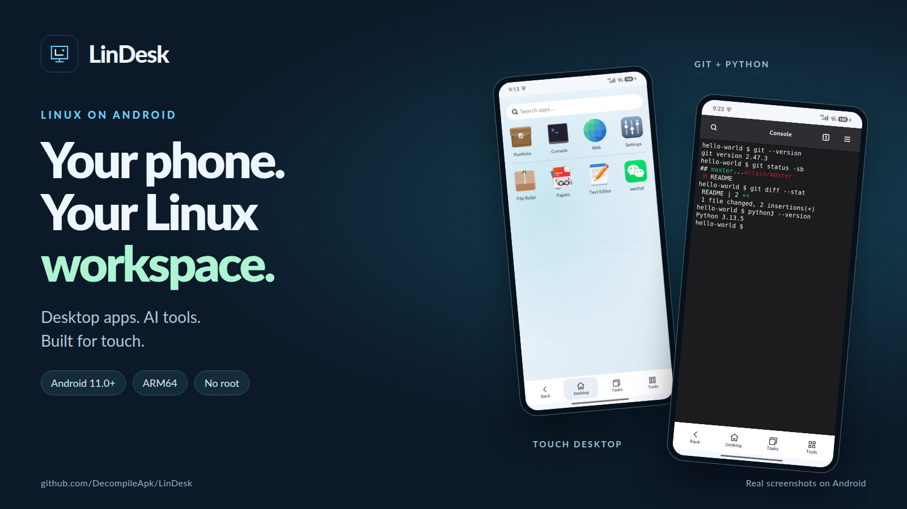
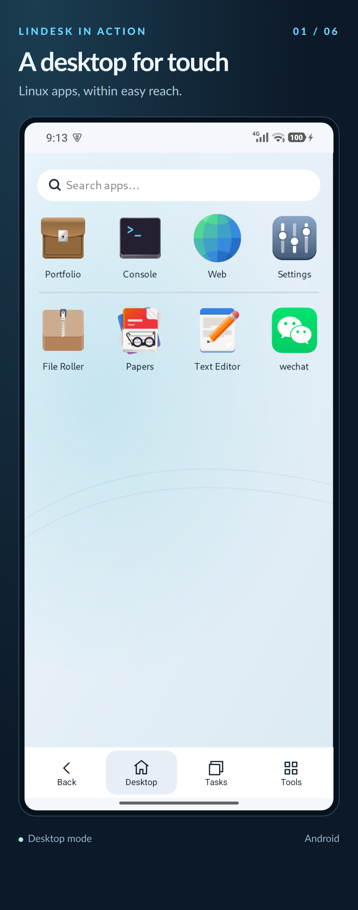
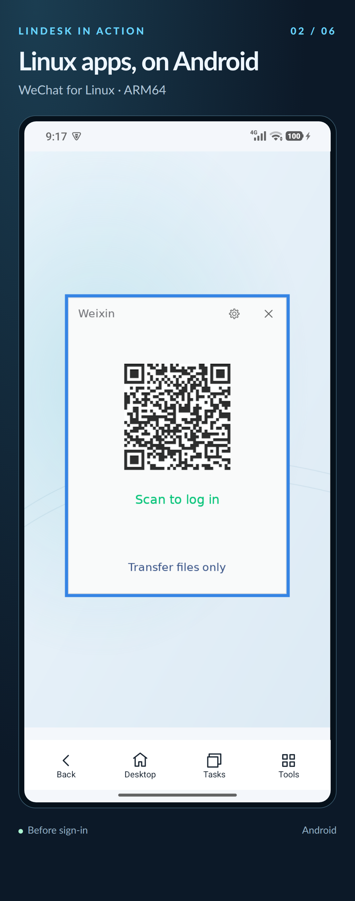
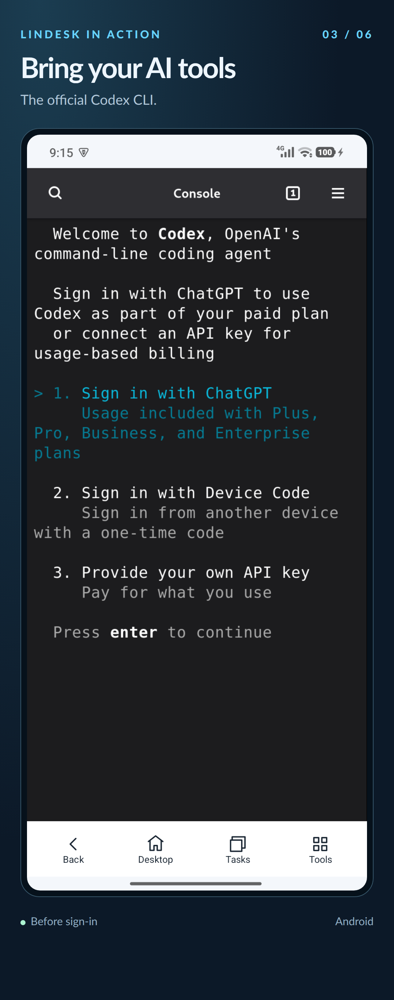
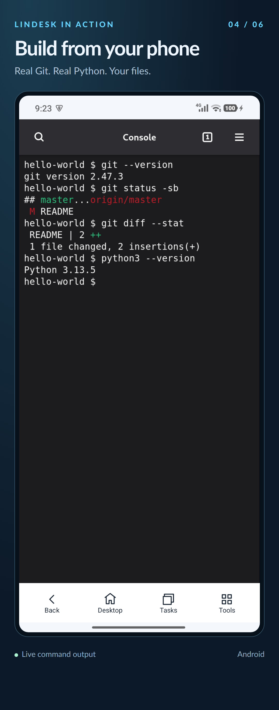
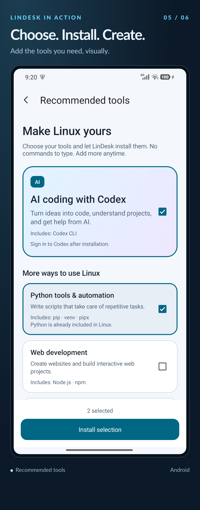
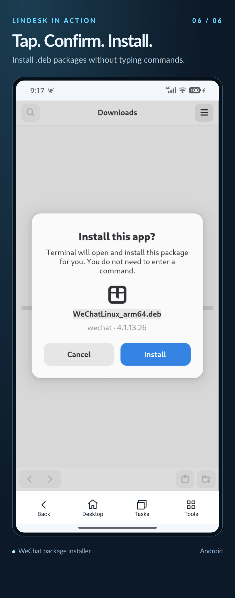

  
  &nbsp;
  

  

  <a href="https://www.youtube.com/shorts/h0DQRq_Ajz0"><strong>▶ 在 YouTube 观看演示</strong></a>

# LinDesk — 把 Linux 工作台装进口袋

**触屏桌面、图形应用、AI 助手，让手机多一种可能。**

在 Android 上使用为手机触屏优化的 Linux 桌面。图形应用、开发工具和 AI 助手，让日常工作与开发任务都能在手机上继续。

  
  &nbsp;
  
  &nbsp;
  
  &nbsp;
  

## 手机上也能顺手使用的 Linux

| 核心亮点 | 能为你做什么 |
| --- | --- |
| **为手机触屏深度优化** | 针对手机触屏进行了大量优化，让 Linux 桌面在手机上也能顺手操作。 |
| **纯终端模式与桌面模式，自由选择** | 偏爱纯终端操作，可直接进入终端环境，无需启动图形桌面；两种模式共用文件和软件。 |
| **开发工具与 AI 助手** | 内置 Git、Python，可按需添加 Codex，让 AI 协助开发、文档处理和任务自动化。 |
| **图形化安装，省心上手** | 选好所需工具，或点开兼容的 `.deb` 软件包，按提示完成安装，无需输入命令。 |
| **文字与文件轻松互通** | 在 Android 与 Linux 之间复制文字、互传文件，方便接续手头的工作。 |
| **真机硬件接入** | 将手机硬件能力带入 Linux，目前已支持扬声器和麦克风，后续可扩展更多硬件。 |

## 看看它实际运行的样子

以下均为 Android 设备上的真实截图。点击卡片可查看大图。

| 触屏桌面 | Linux 微信 | Codex |
| :---: | :---: | :---: |
|  |  |  |

| Git 与 Python | 按需安装工具 | 点击安装 .deb 软件包 |
| :---: | :---: | :---: |
|  |  |  |

## 快速开始

> **下载：** 从 [Google Play](https://play.google.com/store/apps/details?id=linux.on.android.lindesk) 下载 LinDesk。

> [!IMPORTANT]
> **Android 12 及以上：请按系统版本完成子进程设置。** 系统提供“停止限制子进程”开关时，将它设为**开启**，并保持开发者选项开启。**Android 11 无需这项设置。**
>
> 具体方法见 [Android 运行前设置指南](docs/SETUP.zh-CN.md)。

1. **安装 LinDesk。** 从 [Google Play](https://play.google.com/store/apps/details?id=linux.on.android.lindesk) 下载并安装。
2. **完成运行前设置。** 进入“设置 → 运行前设置”，随后选择“启动桌面”或“启动终端”，等待首次初始化完成。
3. **开始使用。** 打开应用，或从“设置 → 推荐工具”添加需要的工具。

**[查看常见问题 →](docs/FAQ.zh-CN.md)** · **[Android 运行前设置 →](docs/SETUP.zh-CN.md)**

## 一起让 LinDesk 更好用

遇到 Bug 或有功能建议，欢迎到 [Issues](https://github.com/DecompileApk/LinDesk/issues) 反馈。

如果 LinDesk 适合你，欢迎 Star，也欢迎分享给想在 Android 上使用 Linux 的朋友。
